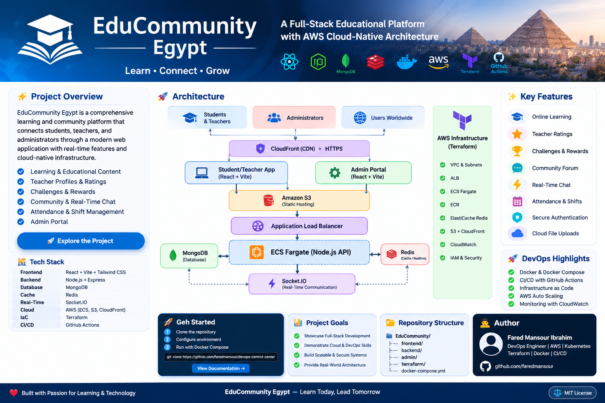

# EduCommunity Egypt 🇪🇬

> A full-stack educational community platform built with React, Node.js/Express, MongoDB, Redis, Socket.IO, Docker, Terraform, and AWS.

EduCommunity combines student/teacher experiences with a separate admin portal, real-time chat, educational materials, challenges, rewards, attendance, teacher shifts, and role-based access control. The repository is structured to demonstrate practical **Full-Stack + Cloud/DevOps engineering** rather than a toy CRUD application.



## Highlights

- React + Vite student/teacher web application
- Separate React/Vite admin portal
- Node.js + Express REST API with service/controller separation
- MongoDB + Mongoose persistence
- JWT access tokens + refresh tokens
- Role-based authorization for students, teachers, and admins
- Socket.IO real-time chat with room access checks
- Redis infrastructure prepared for horizontal Socket.IO scaling
- Cloudinary-backed uploads with strict extension/MIME validation and a 25 MB limit
- Dockerized frontend, admin portal, and backend
- Terraform-managed AWS architecture
- ECS Fargate + ALB + ECR + ElastiCache Redis + S3 + CloudFront
- CloudWatch Container Insights and application logs
- GitHub Actions CI/CD
- Immutable ECR image deployment by digest
- Backend validation/security tests plus frontend/admin build checks

## Architecture

```text
Users
  │
  ├── Student / Teacher Web App
  └── Admin Portal
          │
          ▼
     CloudFront
       │     │
       ▼     ▼
      S3   S3 (Admin)
       │
       └──────────────┐
                      ▼
                 HTTPS / ALB
                      │
                      ▼
                ECS Fargate
                Node / Express
                  │  │  │
        ┌─────────┘  │  └─────────────┐
        ▼            ▼                ▼
     MongoDB       Redis          Cloudinary
        │            │
        │            └── Socket.IO adapter (optional)
        │
        └── application data

Infrastructure: VPC · 2 AZs · private subnets · NAT · SGs
               ECR · IAM · CloudWatch · Auto Scaling · Terraform
```

## Core features

### Authentication & authorization

- Public registration is limited to **student/teacher** accounts.
- Admin and supervisor accounts are provisioned separately through controlled admin/seed flows.
- Access token: 15 minutes.
- Refresh token: 7 days.
- Passwords are hashed with bcrypt.
- Protected API routes use centralized authentication and role authorization middleware.

### Educational content

- Subjects and grade filtering
- Teacher-submitted materials with admin approval
- Ministry/admin materials can be published immediately
- Lessons and Jitsi meeting links
- Search, filtering, pagination, and next-grade content

### Real-time communication

- Socket.IO for live chat
- REST endpoint for message history/fallback
- Room-level authorization
- Private student/teacher rooms
- Redis/Socket.IO adapter integration is optional and can be enabled for multi-instance deployments when the adapter packages are installed.

### Community & gamification

- Posts and comments
- Challenges and submissions
- Leaderboards
- Rewards and badges
- Teacher ratings
- Teacher shifts and attendance tracking

## Security hardening

This version intentionally strengthens the portfolio project without pretending it is a regulated production education system:

- Public signup cannot create an admin account.
- National ID is no longer collected/stored by the demo signup flow.
- Uploads require both an allowed extension and an allowed MIME type.
- Upload filenames are replaced with random server-generated names.
- Uploads are limited to 25 MB and one file per request.
- Local database/Redis ports are not exposed to the host by default in Docker Compose.
- ECR is configured for immutable image tags.
- ECS production secrets are pulled from AWS Secrets Manager.
- S3 buckets are private with public-access blocking, encryption, versioning, and CloudFront Origin Access Control.
- ALB HTTP traffic redirects to HTTPS.
- ElastiCache Redis encryption at rest/in transit is enabled in Terraform.

> Demo note: never seed or commit real student identity documents, national IDs, passwords, or production secrets.

## AWS / Terraform

Terraform defines the main cloud infrastructure:

- VPC across two Availability Zones
- Public/private subnets
- NAT gateways for private workloads
- ECR repository with immutable tags
- ECS Fargate cluster/service
- ALB with HTTPS + HTTP redirect
- Secrets Manager references for runtime secrets
- ElastiCache Redis
- S3 buckets for both frontends
- CloudFront distributions with Origin Access Control
- IAM roles and least-purpose secret access
- CloudWatch log group and ECS Container Insights
- ECS CPU target tracking auto scaling

### Immutable deployment model

GitHub Actions builds an image tagged with the commit SHA, pushes it to ECR, resolves the immutable digest, registers a new ECS task-definition revision using the digest, updates the ECS service, and waits for service stabilization.

Terraform intentionally ignores CI-managed ECS task-definition revisions so a later infrastructure plan does not silently roll the service back to a mutable tag.

## CI/CD

### CI

`.github/workflows/ci.yml` runs on pushes and pull requests:

1. Backend `npm ci` + unit/security-oriented tests
2. Frontend `npm ci` + production build
3. Admin portal `npm ci` + production build

### Deployment

`.github/workflows/deploy.yml`:

1. Builds the backend image
2. Pushes an immutable commit-tagged image to ECR
3. Resolves the ECR digest
4. Registers a new ECS task-definition revision
5. Updates the ECS service
6. Waits for ECS service stability
7. Builds both frontend applications
8. Syncs static assets to S3
9. Invalidates CloudFront caches

## Local development

### 1. Configure backend

```bash
cd backend
cp .env.example .env
# edit .env as needed
npm install
npm test
npm run dev
```

### 2. Run the complete local stack

```bash
docker compose up --build
```

- Student/teacher app: http://localhost:8080
- Admin portal: http://localhost:5200
- API: http://localhost:5000
- API health: http://localhost:5000/api/v1/health

MongoDB and Redis are reachable by the Compose services but are not published to the host by default.

## Demo data

The backend includes a seed script for local/demo data:

```bash
cd backend
npm run seed
```

The seed data is synthetic. Do not replace it with real student information.

## Repository structure

```text
.
├── backend/                 # Express API, services, models, sockets, tests
├── frontend/                # Student/teacher React app
├── admin/                   # Admin React app
├── terraform/               # AWS infrastructure
├── .github/workflows/       # CI/CD
├── docs/architecture/       # Portfolio architecture visual
├── docker-compose.yml       # Local development stack
└── nginx.conf
```

## Technology stack

| Area | Technologies |
|---|---|
| Frontend | React, Vite, Tailwind, React Router |
| Admin | React, Vite, Tailwind |
| Backend | Node.js, Express, Mongoose |
| Database | MongoDB |
| Cache / realtime infrastructure | Redis, Socket.IO |
| Auth | JWT, refresh tokens, bcryptjs, RBAC |
| Files | Cloudinary, Multer |
| Containers | Docker, Docker Compose |
| AWS | ECS/Fargate, ECR, ALB, VPC, S3, CloudFront, ElastiCache, IAM, CloudWatch |
| IaC | Terraform |
| CI/CD | GitHub Actions |
| Testing | Node test runner, frontend build validation |

## Portfolio notes

This repository is intentionally presented as a **cloud-ready full-stack application**. It demonstrates:

- API design and layered backend architecture
- Authentication and RBAC
- Real-time communication
- Containerization
- Infrastructure as Code
- AWS networking and managed services
- Immutable deployment practices
- CI/CD automation
- Security-minded defaults
- Operational observability

It is not presented as a Kubernetes project; the AWS deployment path in this repository is ECS/Fargate + Terraform.

## License

For portfolio/demo use. Add your preferred open-source license before public redistribution.
